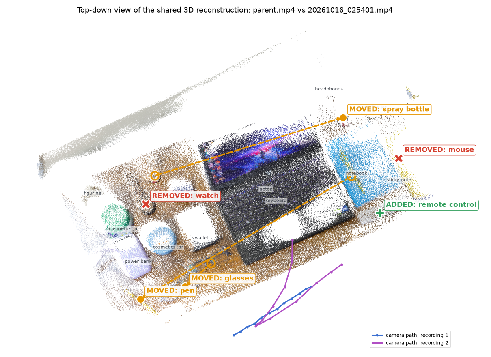
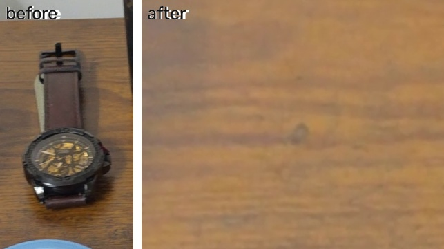
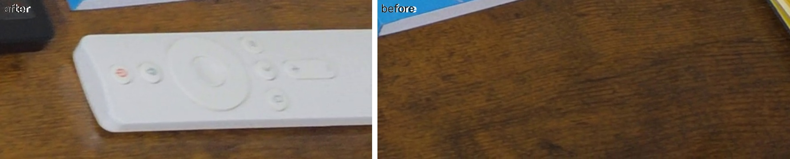
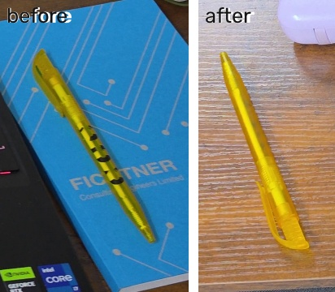
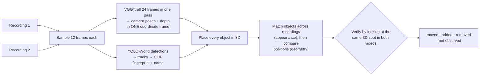

# What changed on the desk?

Two handheld phone videos of the same space, filmed at different times from
different paths. This system rebuilds both in **one shared 3D scene**, finds
every object that was **moved, added or removed**, describes each change in
plain English, and shows where it happened in 3D.



*Recording 1 (`parent.mp4`) vs recording 2 (`20261016_025401.mp4`), seen from
above. Blue and purple lines are the two camera paths. Every marked change
was detected automatically.*

```text
- moved:   The spray bottle moved from next to the stapler to next to the cosmetics jar.
- moved:   The glasses moved from next to the wallet to between the cosmetics jar and the wallet.
- moved:   The pen moved from next to the notebook to next to the power bank.
- removed: The watch was removed from between the cosmetics jar and the stapler.
- removed: The mouse was removed from next to the sticky note.
- added:   A remote control was added between the sticky note and the notebook.
```

(The "stapler" is the earbuds case and the "sticky note" is a yellow notepad.
Names come from an open vocabulary, so they are close but not always exact.)

## Results

Recording 1 is compared with two second recordings. Each was filmed along a
different path (one pans the opposite way, one starts with a close-up) after
moving, adding and removing objects.

| Second recording | Real changes | Found | Missed | False alarms |
|---|---|---|---|---|
| `20261016_025318.mp4` | glasses moved, pen moved, watch removed, remote added | 4 | 0 | 0 |
| `20261016_025401.mp4` | glasses, pen and spray bottle moved; watch and mouse removed; remote added | 6 | 0 | 0 |

Two of these changes were not on my own list when I first reviewed the
footage: the spray bottle moving behind the laptop, and the glasses being
nudged when the pen was put down. The system flagged both. Checking the
frames confirmed they were real.

### Evidence for each change

Every reported change comes with a crop from each recording. For a removal,
the second crop shows **the same 3D spot in the other video**, now empty. It
is found by projecting the object's 3D box into the other recording's
cameras.

| Removed: watch | Added: remote | Moved: pen |
|---|---|---|
|  |  |  |

Each run writes:

| File | What it is |
|---|---|
| `report.md` | The changes in plain English |
| `scene_3d.html` | Interactive 3D view: coloured point cloud of both recordings, both camera paths, and every change as a labelled 3D box, with arrows for moves. Open it in a browser. |
| `change_map.png` | The top-down view above |
| `evidence/` | Before/after crops per change |
| `changes.json` | Machine-readable: type, label, 3D position, destination for moves, evidence scores |
| `decisions.log` | One line per object explaining *why* it was judged moved, added, removed, unchanged or not observed, with the numbers behind the decision |

Full example outputs for both pairs are in [`outputs/scene_A`](outputs/scene_A) and
[`outputs/scene_B`](outputs/scene_B).

## How it works



1. **One shared 3D scene, no alignment step.** Frames from *both* videos go
   through [VGGT](https://github.com/facebookresearch/vggt) together. It
   predicts camera poses and per-pixel depth for all of them in a single
   coordinate frame, so the two recordings are registered by construction.
   On this data, the median gap between surfaces seen in recording 1 and
   recording 2 is under 1% of the scene size.
2. **Objects.** YOLO-World, with a generic list of ~40 everyday objects,
   finds candidates in every frame. Detections are tracked within each video
   and merged when two labels keep landing on the same box. Each object gets a
   CLIP image embedding, and CLIP picks its name from the same list.
3. **3D placement.** Each object's position comes from the depth inside the
   central part of its boxes. Boxes cut off by the frame edge are skipped,
   because their centre isn't the object's centre.
4. **Matching.** Objects are paired across recordings by appearance
   (Hungarian algorithm on CLIP similarity), deliberately ignoring the
   detector's labels, which flip between recordings.
5. **Classification.**
   - *Moved*: matched, its centre shifted, **and** its 3D surfaces no longer
     overlap.
   - *Removed* / *added*: no match, and the other recording **did look at
     that spot**.
   - *Not observed*: no match, but the other recording never had a clear
     view. This is reported separately and never counted as a change.
6. **Verification by looking.** Before any change is reported, the object's
   3D box is projected into both recordings and the two crops are compared.
   A change is confirmed only if the spot looks different, *or* it no
   longer looks like that object.

## Design choices and trade-offs

**Appearance finds the candidates; geometry and direct visual checks decide.**
Appearance alone is fooled by look-alikes: a dark earbuds case resembles a
dark mouse. Geometry alone is fooled by noisy positions: a notepad that's half
out of frame "moves" with the camera. Each decision therefore needs both to
agree, and the final word goes to the most direct evidence available: what
the same 3D spot looks like in each recording.

**"Not seen" is not "gone".** A removal needs at least 2 frames of the other
recording that saw the spot unobstructed. Visibility is checked by projecting
into each camera and comparing against VGGT's depth at that pixel. If
something nearer is in the way, that frame doesn't count. This is what keeps
a bag in a corner that the second recording never filmed out of the report.

**Moves are paired, not inferred.** A would-be removal and a would-be addition
that look alike (CLIP ≥ 0.82) are reported as one move. The bar is lower than
for "same object" (0.855) because appearance shifts with the background: the
pen on a blue notebook and the pen on a wooden desk score only 0.84.

**Every decision is explained.** `decisions.log` records the deciding
numbers for each object. Most of the rules above were added by reading that
log, finding a wrong call, and fixing the underlying cause rather than the
symptom.

**Feed-forward 3D instead of classical SfM.** COLMAP-style reconstruction
was the first plan, but its native library was blocked by the development
machine's security policy. VGGT runs on plain PyTorch, needs no feature
matching or bundle adjustment, and handles the low-texture, partly
overlapping views of handheld clips well. The cost is speed: about 20 minutes
on CPU for 24 frames.

**Two complementary visual checks.** On this data:

| Check | Real changes | Unchanged |
|---|---|---|
| Same 3D region, recording 1 vs 2 (CLIP similarity) | 0.68 – 0.79, **mouse 0.89** | 0.94 – 0.96 |
| Drop in "looks like this object" at its spot | 0.10 – 0.28 | −0.02 – 0.02 |

The region check alone misses the mouse. It is a small object on a large
yellow notepad, so the notepad dominates both crops. That is why the second
check exists: it asks whether the spot still looks like *the mouse*, not
whether the region looks the same.

### Limitations

- **Thresholds were tuned on these two pairs.** The gaps above are wide, but
  they come from one scene. New rooms or lighting may need re-checking, and
  `decisions.log` shows the numbers to do it with.
- **Only detected objects can change.** If the detector never fires on an
  object in either video, it is invisible. Region-level comparison of the
  whole reconstruction (not only detected objects) would close this gap.
- **Speed.** About 20–25 minutes per pair on a 20-core CPU, almost all of it
  VGGT. A GPU brings this to seconds.
- **Names are approximate.** CLIP picks from a fixed list, so an earbuds
  case can come out as "stapler". The 3D positions and evidence crops are
  what to trust.
- **Scale is relative.** VGGT's units are arbitrary, so distances are
  reported as fractions of the scene size, not metres.

## Running it

Tested on Windows 11, Python 3.11, CPU only.

```bash
python -m venv .venv
.venv\Scripts\activate            # Linux/macOS: source .venv/bin/activate
pip install -r requirements.txt
# VGGT declares numpy<2 but runs fine on numpy 2; --no-deps keeps the stack consistent
pip install --no-deps https://github.com/facebookresearch/vggt/archive/refs/heads/main.zip
```

Model weights download automatically on first run: VGGT-1B (~5 GB, from
Hugging Face), YOLO-World (`yolov8s-worldv2.pt`, 25 MB) and CLIP ViT-B/32.

```bash
python scene_change_3d.py --before videos/parent.mp4 --after videos/20261016_025401.mp4 --out-dir outputs/scene_B
```

Add `--explain` to print the reasoning for every object. The reconstruction
and detections are cached in the output folder, so re-running (for example
with different thresholds) takes a few minutes instead of 20. `--help` lists
every threshold and what it does.

**Recording your own:** two clips of the same area, about 3–7 seconds each,
moving slowly. Overlap matters more than coverage. The second clip can take a
different path, but it should pass over the spots where you changed things.
Both clips must have the same resolution and orientation.

## Repository layout

| Path | Contents |
|---|---|
| `scene_change_3d.py` | The 3D change-detection system (entry point) |
| `find_missing.py` | Detection, tracking, label merging and CLIP utilities it builds on |
| `videos/` | The three example recordings |
| `outputs/scene_A`, `outputs/scene_B` | Full example outputs for both pairs |
| `docs/earlier_2d_work.md` | The project's first stage: 2D removal detection between videos, and how it evolved |
| `evaluate.py`, `video_info.py`, `sample_frames.py`, `detect_one.py`, `check_setup.py` | Small tools from the 2D stage |
